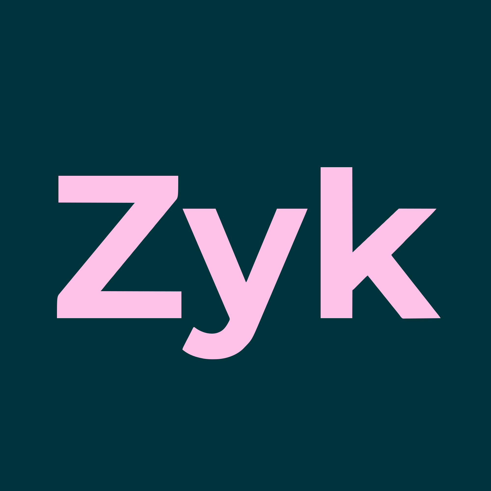

<p align="center">
  
</p>

# zyk — durable processes for AI assistants

> **v2, milestone 1.** This branch is the v2 rewrite. Looking for v1 (the MCP server that
> generates Hatchet workflow code)? See tag [`v1.0.0`](../../tree/v1.0.0) or branch [`v1`](../../tree/v1).

Your AI assistant can act in all your tools via MCP, but it has no clock, no durable state,
and no memory across days. It can't reliably run "triage this incident, wait for the SLA,
check the issue, escalate if nobody responded."

zyk is the durable brain; your assistant is the worker:

- zyk runs **playbooks** on [Hatchet](https://hatchet.run): state, timers, waits, retries,
  approvals, and an audit log.
- Your assistant **pulls tasks** from zyk over MCP (fetch-and-lock), does them with your own
  connectors, and reports structured results. **zyk never sees your credentials.**
- Human decisions are **user tasks**: your assistant asks you in the conversation. Nothing
  irreversible happens without your approval, and unattended runs never decide for you.
- zyk is a remote MCP server. It never wakes your assistant; you or a scheduled run do.

```
 mail ──▶ zyk (Hatchet) ──tasks──▶ your assistant ──▶ GitHub, Gmail, ...
             ▲   timers, state,        │  asks you decisions
             └── approvals, audit ◀────┘  results
```

## Incident triage (the first playbook)

Incident mail → triage and duplicate check → you confirm the severity → GitHub issue →
acknowledgement draft → you approve → mail sent → wait for the severity's SLA → check the
issue → escalate if nothing happened → resolution draft when it's closed → you approve → mail
sent. Every step is visible with `get_instance`.

## Getting started

1. **Deploy zyk:** [Railway](docs/deploy-railway.md) (Postgres + Hatchet + zyk), or locally
   (below).
2. **Create a key:** `npm run admin -- tenant:create <your name>`.
3. **Connect your assistant:** [Claude setup](docs/assistant/claude-setup.md): custom
   connector, project instructions, hourly scheduled run. Other clients:
   [docs/assistant/other-clients.md](docs/assistant/other-clients.md).
4. In a chat say "zyk". Your assistant fetches the due tasks and asks you what it needs.

## Local development

Requires Node 20 and Docker.

```bash
docker compose up -d postgres hatchet-engine   # Postgres on :5433, Hatchet UI on :8888
cp .env.example .env
node scripts/generate-token.js                 # put the token in .env (HATCHET_CLIENT_TOKEN)
cd mcp-server
npm install
npm run dev                                    # http://localhost:3100/mcp, health: /healthz
npm run admin:dev -- tenant:create local-dev   # prints an API key (shown once)
```

Connect Claude Code: `claude mcp add --transport http zyk http://localhost:3100/mcp --header "Authorization: Bearer <key>"`.

```bash
npm test           # unit + Postgres integration (recreates zyk_test)
npm run test:e2e   # real Hatchet, simulated assistants, ~2 min
```

## Docs

- [Architecture and decision log](docs/v2-architecture.md)
- [Railway deployment](docs/deploy-railway.md)
- [Assistant setup](docs/assistant/README.md)
- [Contributing](CONTRIBUTING.md) · [Security](SECURITY.md) · [Changelog](CHANGELOG.md)

## License

See [LICENSE](LICENSE).
